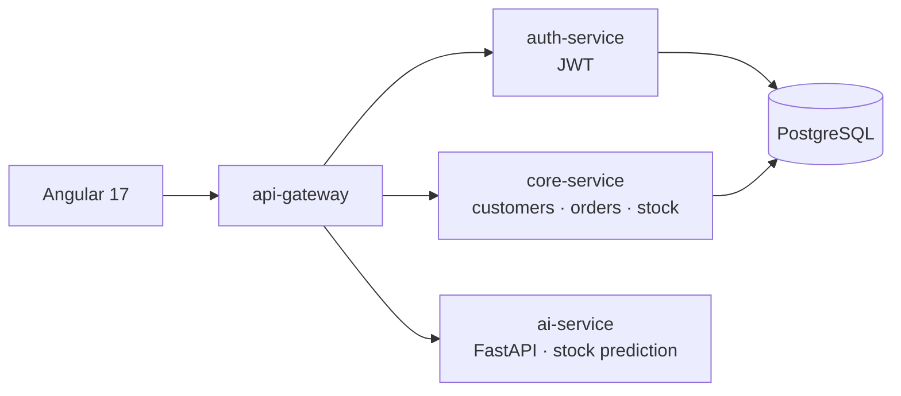

# 📊 Decision-Support ERP / CRM Platform with AI — v1 (prototype)

> First version of my ERP/CRM platform: **Spring Boot microservices** behind an API gateway, an **Angular 17** front-end and a **FastAPI** service for stock prediction.

> ➡️ **The complete, multi-tenant version lives in [PFA_CRM_ERP_Platform](https://github.com/MohamedTrikii/PFA_CRM_ERP_Platform)** (9 microservices, Keycloak, RabbitMQ, RAG assistant, Flutter app). This repository is kept as the initial prototype.

🇫🇷 [Version française](#-version-française)


## 🧠 Architecture



| Folder | Content |
|---|---|
| `backend/api-gateway` | Spring Cloud Gateway, routing |
| `backend/auth-service` | authentication, JWT |
| `backend/core-service` | customers, products, orders, stock, dashboard, audit |
| `ai-service/` | FastAPI, stock predictor |
| `frontend/` | Angular 17 application |
| `database/init.sql` | schema and seed data |

## 🚀 Run

```powershell
copy .env.example .env      # set your own values
docker compose up -d --build  # PostgreSQL + 3 Spring services + AI service + frontend
```

On Windows you can also run the services locally with `.\start.ps1`.

---

## 🇫🇷 Version française

**Première version** de ma plateforme ERP/CRM décisionnelle : microservices **Spring Boot** derrière une passerelle, front-end **Angular 17** et service **FastAPI** de prédiction de stock.

➡️ **La version complète et multi-tenant se trouve dans [PFA_CRM_ERP_Platform](https://github.com/MohamedTrikii/PFA_CRM_ERP_Platform)** (9 microservices, Keycloak, RabbitMQ, assistant RAG, application Flutter). Ce dépôt est conservé comme prototype initial.

Lancement : copier `.env.example` en `.env`, puis `docker compose up -d --build` (ou `.\start.ps1` sous Windows).

## 👤 Author / Auteur

**Mohamed Triki** — [GitHub](https://github.com/MohamedTrikii)
