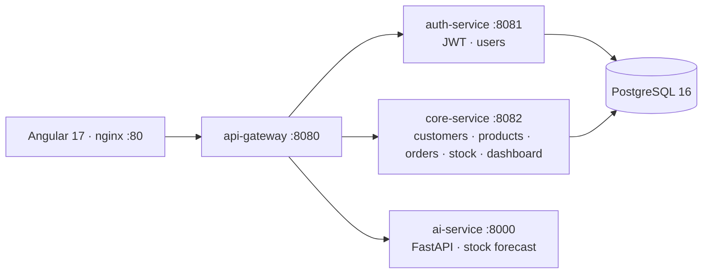

# 📊 Decision-Support ERP / CRM Platform with AI — v1 (prototype)

> First version of my ERP/CRM platform: three **Spring Boot microservices** behind an API gateway (authentication, business core, routing), an **Angular 17** back-office and a **FastAPI** service that forecasts stock needs — all started with one `docker compose` command.

> ➡️ **The complete, multi-tenant version is [PFA_CRM_ERP_Platform](https://github.com/MohamedTrikii/PFA_CRM_ERP_Platform)** (9 microservices, Keycloak, RabbitMQ, Row-Level Security, RAG assistant, Flutter app). This repository is kept as the initial prototype that validated the architecture.

🇫🇷 [Version française](#-version-française)


## ✨ Features

- **Authentication** (`auth-service`) — registration, login with **JWT**, user roles, account activation / deactivation.
- **Customers** — list, create / edit in dialogs, status `ACTIVE / INACTIVE / PROSPECT`.
- **Products** — catalogue with status `ACTIVE / INACTIVE / DISCONTINUED`.
- **Orders** — order lines and a status flow `PENDING → CONFIRMED → PROCESSING → SHIPPED → DELIVERED` (or `CANCELLED`), order detail dialog.
- **Stock** — quantity per product, **low-stock** list, bulk update.
- **Dashboard** — KPIs (counts, revenue) and charts.
- **Platform** — tenants, system configuration, audit log of changes.
- **AI stock forecast** (`ai-service`) — a scikit-learn **linear regression** trained on the sales history of a product predicts the next periods, with the R² score and a confidence interval derived from the residuals.

## 🧠 Architecture



| Folder | Content |
|---|---|
| `backend/api-gateway` | Spring Cloud Gateway, routing to the services |
| `backend/auth-service` | registration, login, JWT, user management |
| `backend/core-service` | customers, products, orders, stock, dashboard KPIs, tenants, system config, audit |
| `ai-service/` | FastAPI router `/predict/stock` + `StockPredictor` |
| `frontend/erp-frontend/` | Angular 17 application served by nginx (Docker image) |
| `database/init.sql` | schema and seed data |

## 🚀 Run

```powershell
copy .env.example .env          # set your own values
docker compose up -d --build    # PostgreSQL + 3 Spring services + AI service + frontend
```

Then open **http://localhost**. On Windows you can also run the services locally with `.\start.ps1`.

---

## 🇫🇷 Version française

**Première version** de ma plateforme ERP/CRM décisionnelle : trois **microservices Spring Boot** derrière une passerelle (authentification, cœur métier, routage), un back-office **Angular 17** et un service **FastAPI** de prévision des besoins en stock, le tout lancé par une seule commande `docker compose`.

➡️ **La version complète et multi-tenant est [PFA_CRM_ERP_Platform](https://github.com/MohamedTrikii/PFA_CRM_ERP_Platform)** (9 microservices, Keycloak, RabbitMQ, Row-Level Security, assistant RAG, application Flutter). Ce dépôt est conservé comme prototype initial, qui a validé l'architecture.

**Fonctionnalités**
- **Authentification** : inscription, connexion par **JWT**, rôles, activation / désactivation des comptes.
- **Clients** : liste, création / modification, statut `ACTIVE / INACTIVE / PROSPECT`.
- **Produits** : catalogue avec statut `ACTIVE / INACTIVE / DISCONTINUED`.
- **Commandes** : lignes de commande et cycle `PENDING → CONFIRMED → PROCESSING → SHIPPED → DELIVERED` (ou `CANCELLED`).
- **Stock** : quantité par produit, liste des stocks bas, mise à jour en lot.
- **Tableau de bord** : indicateurs (volumes, chiffre d'affaires) et graphiques.
- **Plateforme** : tenants, configuration système, journal d'audit.
- **Prévision de stock par IA** : une **régression linéaire** scikit-learn entraînée sur l'historique des ventes d'un produit prédit les périodes suivantes, avec le score R² et un intervalle de confiance calculé à partir des résidus.

**Lancement** : copier `.env.example` en `.env`, puis `docker compose up -d --build`, et ouvrir **http://localhost** (ou `.\start.ps1` sous Windows).

## 👤 Author / Auteur

**Mohamed Triki** — [GitHub](https://github.com/MohamedTrikii)
